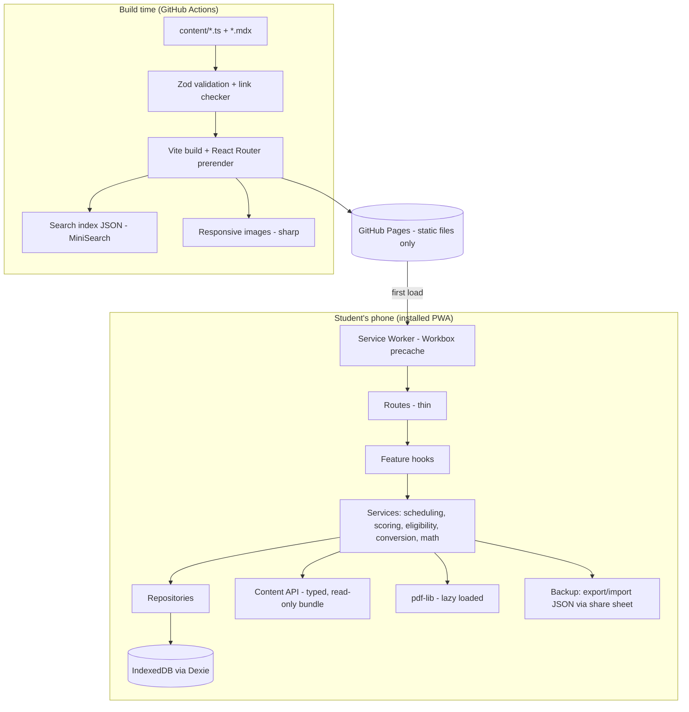

# Architecture



## Layering rule

route → feature component → hook → service → repository/content. Components
never touch Dexie. Services are pure TypeScript and unit-tested without a browser.

## Libraries (all free, MIT/Apache, no accounts)

- vite, react, react-router v7, vite-plugin-pwa
- dexie, dexie-react-hooks
- zod
- ts-fsrs (FSRS scheduler)
- minisearch
- pdf-lib, qrcode
- tailwindcss v4, @radix-ui/*, lucide-react (one stroke weight)
- vitest, @testing-library/react, playwright, axe-core
- eslint, prettier, husky, lint-staged

## Design foundations

**Type:** Fraunces (display) paired with Inter (UI), self-hosted with no Google Fonts call.

**Palette:**

- Charcoal and warm off-white neutrals
- One accent, **oxblood**, with brass reserved for certificate and achievement moments only
- Semantic colors for success, warning and danger

Radius is 6px everywhere, spacing is on an 8px grid, and motion is 150–250ms ease-out and honors
reduced motion.

## Folder layout

```
src/
  app/routes/            thin route modules
  features/{curriculum,library,my-bar,practice,assessment,responsible-service,certificate,progress,onboarding,backup}/
     components/ hooks/ services/ model/
  design-system/{tokens,components,patterns}/
  content/{programs,cocktails,ingredients,questions,scenarios}/   + schema.ts
  lib/{db,config,rng,units,pdf}/
docs/{adr,data-model.md,content-style-guide.md}
e2e/
```

---

## Route map

| Route                            | Purpose                                                   | Prerendered |
| -------------------------------- | --------------------------------------------------------- | ----------- |
| `/`                              | Today: next lesson, review queue count, streak, continue  | shell       |
| `/welcome`                       | Age gate or framing, name, units, install prompt          | ✓           |
| `/learn`                         | Program overview with course progress                     | shell       |
| `/learn/:course`                 | Course: modules, lessons, exam status                     | ✓           |
| `/learn/:course/:lesson`         | Lesson player                                             | ✓           |
| `/library`                       | Spec search and filters                                   | ✓           |
| `/library/:cocktail`             | Spec card                                                 | ✓ (×100)    |
| `/library/techniques/:technique` | Technique reference                                       | ✓           |
| `/library/spirits/:category`     | Spirit category guide                                     | ✓           |
| `/my-bar`                        | Inventory, what I can make, next bottle to buy            | shell       |
| `/practice`                      | Practice hub                                              | shell       |
| `/practice/review`               | FSRS recall session                                       | —           |
| `/practice/speed`                | Speed Round ticket rail                                   | —           |
| `/practice/pour`                 | Pour trainer                                              | —           |
| `/practice/math`                 | Bar math trainer                                          | —           |
| `/exam/:course`                  | Exam intro, attempt and results                           | —           |
| `/responsible-service`           | RS module hub and scenarios                               | ✓           |
| `/capstone`                      | Service Sim                                               | —           |
| `/certificate`                   | Eligibility checklist, then generate and share PDF        | shell       |
| `/progress`                      | Self-coaching dashboard                                   | shell       |
| `/settings`                      | Units, theme, backup/restore, reset, about/privacy, legal | ✓           |
| `/design-system`                 | Tokens, type, every component and state                   | ✓           |
| `*`                              | Designed 404                                              | ✓           |

**Navigation:** a bottom tab bar on mobile (Today · Learn · Library · Practice · Progress) and a
left rail on desktop.

---

Routes marked ✓ are prerendered; "shell" routes prerender their loading state and fill in from
the device after hydration. Routes ship in the milestone that builds them. Today only `/`,
`/design-system` and the 404 exist.
