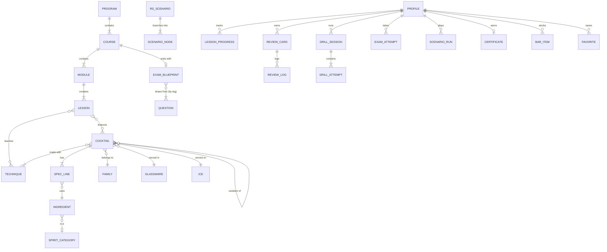

# Data model

There are two layers. **Content** is static, versioned, bundled at build time and validated with
Zod in CI. **User state** lives in Dexie/IndexedDB with versioned schema migrations. User records
reference content by **stable slug IDs**. A `contentMigrations` map handles renamed or removed
content.

**Content entities:**

- **Cocktail:** `id, name, familyId, difficulty(1–3), glassId, iceId, method(shake|stir|build|throw|swizzle|blend), garnish, specLines[{ingredientId, amountMl|unit, note}], buildOrder[], techniqueIds[], history, variationOfId?, tags`
- **Lesson:** `id, moduleId, order, type(reading|technique|drill|quiz), title, estMinutes, body(MDX), blocks[], cocktailIds[], techniqueIds[], completionRule`
- **Question:** `id, type(single|multi|order|numeric|spec-build), prompt, options, answer, explanation, tags[courseId, topic], difficulty`
- **ExamBlueprint:** `courseId, sections[{tag, count}], passMark, timeLimitSec, cooldownHours`
- **RsScenario:** a node graph of guest dialogue. Each choice node carries feedback and a
  correct, acceptable or unsafe weight.

**User entities (Dexie):**

- **Profile:** `displayName, units, ageGateAck{mode, at}, theme, installedPromptSeen, createdAt`
- **LessonProgress:** `lessonId, status, blockState, startedAt, completedAt`
- **ReviewCard:** `cardId(cocktailId:facet), fsrs{due, stability, difficulty, reps, lapses, state}`
- **ReviewLog:** `cardId, rating, reviewedAt, elapsedMs`
- **DrillSession / DrillAttempt:** `kind(speed|pour|math|build), score, durationMs, items[{target, response, correct, ms}]`
- **ExamAttempt:** `examId, seed, questionIds snapshot, answers, score, topicBreakdown, passed, startedAt, submittedAt`
- **ScenarioRun:** `scenarioId, path[], outcome`
- **Certificate:** `id (ULID), programId, displayName, issuedAt, contentVersion`
- **BarItem:** `ingredientId`
- **Favorite:** `cocktailId`
- **Meta:** `schemaVersion, lastBackupAt`

---

## Implementation status

The ERD above is the approved target. Tables land in the milestone that first uses them, each as a
new Dexie `version()` block, so every release runs a real migration.

| Schema version | Milestone | Tables added | Notes                                             |
| -------------- | --------- | ------------ | ------------------------------------------------- |
| 1              | M0        | `meta`       | Device-level settings (`installHintDismissedAt`). |

Theme preference is deliberately **not** in IndexedDB: it lives in `localStorage` under
`academy.theme` so it can be applied before first paint (ADR 0003).
