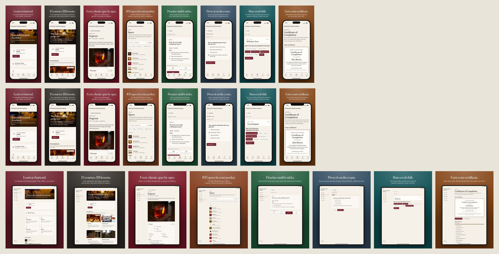

# App Store screenshots

Eight captioned panels, in three sets, at the sizes App Store Connect asks for. Each one is a real
capture of the production build, using sample progress (a student two weeks in, and a graduate for
the certificate). Nothing in the app UI is mocked or painted over.



| Folder                    | App Store Connect row | Size (portrait) | Needed?                                       |
| ------------------------- | --------------------- | --------------- | --------------------------------------------- |
| `screenshots/iphone-6.9/` | iPhone 6.9" Display   | 1320 × 2868     | Yes. Apple scales it down to smaller iPhones. |
| `screenshots/iphone-6.5/` | iPhone 6.5" Display   | 1284 × 2778     | Only if that row asks for its own set.        |
| `screenshots/ipad-13/`    | iPad 13" Display      | 2064 × 2752     | Yes. The app runs on iPad.                    |

All files are sRGB JPEG with no transparency, which Apple accepts.

## Upload

1. Open **App Store Connect → NCA → the version you're submitting → Previews and Screenshots**.
2. Drag the eight files from `iphone-6.9/` into the **iPhone 6.9" Display** row, in file-name order.
3. Switch to **iPad**, then drag the files from `ipad-13/` into the **iPad 13" Display** row.
4. If the 6.5" row asks for screenshots, drag in the files from `iphone-6.5/`.

The first three panels show in search results, so they lead with the strongest points.

## The storyboard

| #   | Screen         | Headline                     | Subline                                                                            |
| --- | -------------- | ---------------------------- | ---------------------------------------------------------------------------------- |
| 1   | Today          | Learn to bartend.            | A complete bartending program. Free, offline, no account.                          |
| 2   | Learn          | 15 courses. 111 lessons.     | Tools, glassware, technique, garnishes and service, then every family of classics. |
| 3   | Negroni lesson | Every classic, spec by spec. | Glass, ice, method and garnish, in ounces or milliliters.                          |
| 4   | Spec library   | 105 specs in your pocket.    | The IBA official list plus modern classics. Search by name or ingredient.          |
| 5   | Daily Review   | Practice until it sticks.    | Daily review brings each spec back right before you'd forget it.                   |
| 6   | Course exam    | Prove it on the exam.        | Every course ends with an exam. Pass with 80%, retake any time.                    |
| 7   | Service Sim    | Run a real shift.            | The Service Sim: drinks from memory, guests to handle, a clock running.            |
| 8   | Certificate    | Earn your certificate.       | Pass every exam and the Service Sim, then save it as a PDF.                        |

Every claim must stay true. If the course or spec count, the pass mark or a feature changes, update
the captions in `scripts/store/screenshots.mjs` and regenerate. The certificate shows a fictional
name, "Alex Rivera".

## Regenerate

```bash
pnpm store:screenshots
```

This builds the app, restores the sample progress from `scripts/store/seed.ts` through the app's
own backup screen, captures each screen in Chromium, lays out the panels and writes the files
here. Pass `--skip-build` to reuse the current build. The exam question and the Service Sim drink
are dealt at random, so they change from run to run.
